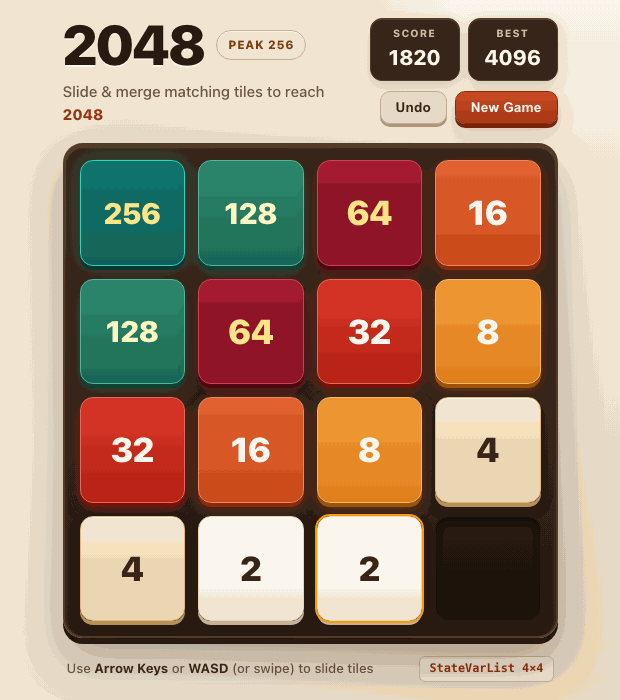

# 2048

Interactive **2048** puzzle game built with **TypeScript**, **React**, **Vite**, and **[`statebinderk`](https://www.npmjs.com/package/statebinderk)**, live at [mk314k.github.io/2048/](https://mk314k.github.io/2048/).

## Preview



## Architecture & Features

- **Direct `StateVarList` 4×4 Cell Binding (`src/boardBinder.ts`)**: React renders the static 16-cell board shell (`#cell-0-0` .. `#cell-3-3`) and scoreboard once, while `statebinderk` (`StateVarList` & `StateVar`) transitions targeted tile classes, values, spawn/merge animations, and scores directly without re-rendering the grid tree.
- **4×4 Grid Engine (`src/gameEngine.ts`)**: Single-merge-per-turn row/column sliding, 90/10 `2`/`4` tile spawning, score deltas, and dead-end detection.
- **Score, Persistent Best & Undo**: Tracks live score deltas (`+512`), persists high scores in `localStorage`, and supports 1-step **Undo** plus **Keep Going** mode past `2048`.
- **Desktop & Mobile Controls**: Play with **Arrow Keys**, **WASD**, or touch swipe gestures.

## Getting Started

```bash
npm install
npm run dev
```

## License

Licensed under the [MIT License](LICENSE).
